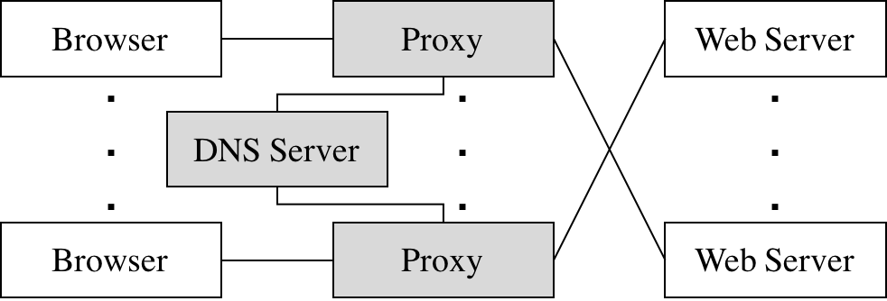

# Video Streaming via CDN

This project implements a simplified video content delivery network (CDN) that demonstrates two techniques real streaming services use: adaptive bitrate selection, which picks the video quality the connection can support, and DNS-based load balancing, which picks which server a client uses.

The whole system runs inside [Mininet](http://mininet.org/), which simulates several hosts with their own IP addresses and lets you control each link's bandwidth and latency.



## What it does

- **[`miProxy`](miProxy/)** is an HTTP proxy, written in C++ with POSIX sockets, that sits between a browser and the video web server. For each chunk of an HLS video stream, it measures the throughput to the server, smooths that measurement with an exponentially weighted moving average (EWMA), and rewrites the browser's request to fetch the highest quality the connection can reliably support. It handles several browser connections at once and logs statistics for every chunk.
- **[`nameserver`](nameserver/)** is a minimal authoritative DNS server that answers queries for a single domain (`video.cdn.assignment2.test`) with the IP address of one of several web servers. It has two modes:
  - **Round robin:** it cycles through a fixed list of server IP addresses.
  - **Geographic (lowest cost):** it finds the shortest path through a network topology file, using Dijkstra's algorithm, and returns the server closest to the client that asked.

Together, they let an ordinary web browser, such as Chromium, stream HLS video at the best quality the network allows, from the most suitable server.

## Key features

- Adaptive bitrate logic moved out of the video player and into the proxy
- Throughput measured for each video chunk, smoothed with an EWMA
- HLS manifest parsing, and request rewriting to switch bitrates
- One process per browser connection (`fork()`), with `select()` relaying data in both directions between the browser and the server
- DNS message parsing and response generation
- Fixed log formats for both the proxy and the name server

## Directory structure

| Folder | Contents |
| --- | --- |
| `miProxy/` | Source code and Makefile for the HTTP proxy |
| `nameserver/` | Source code and Makefile for the DNS server |
| `.DNS/` | DNS message classes shared by both programs (linked into each folder as `DNS/`) |
| `grader/` | Mininet topology scripts, a test web server, sample topology and IP-list files, and tests |
| `.images/` | Diagrams |

## How to run

### 1. Build both programs

This requires `g++` with C++20 support:

```bash
cd miProxy && make
cd ../nameserver && make
```

### 2. Start a topology

Run the topology scripts from the `grader/` folder. Mininet needs root privileges, so these scripts usually run with `sudo`.

For one web server and one proxy:

```bash
cd ../grader
sudo python3 startTopologyMininet.py
```

Then open `http://10.0.2.100:9000` in Chromium.

For two web servers, two proxies and the DNS server:

```bash
cd ../grader
sudo python3 startTopologyMininetMultiHost.py
```

Then open `http://10.0.4.100:9000` or `http://10.0.5.100:9000`.

See [`miProxy/README.md`](miProxy/README.md) and [`nameserver/README.md`](nameserver/README.md) for each program's command-line options.
